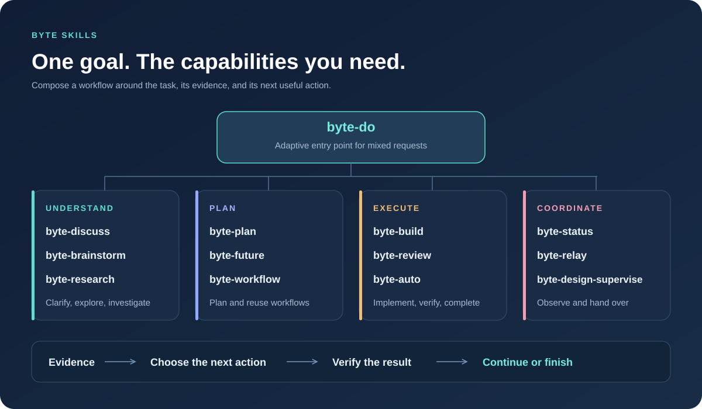
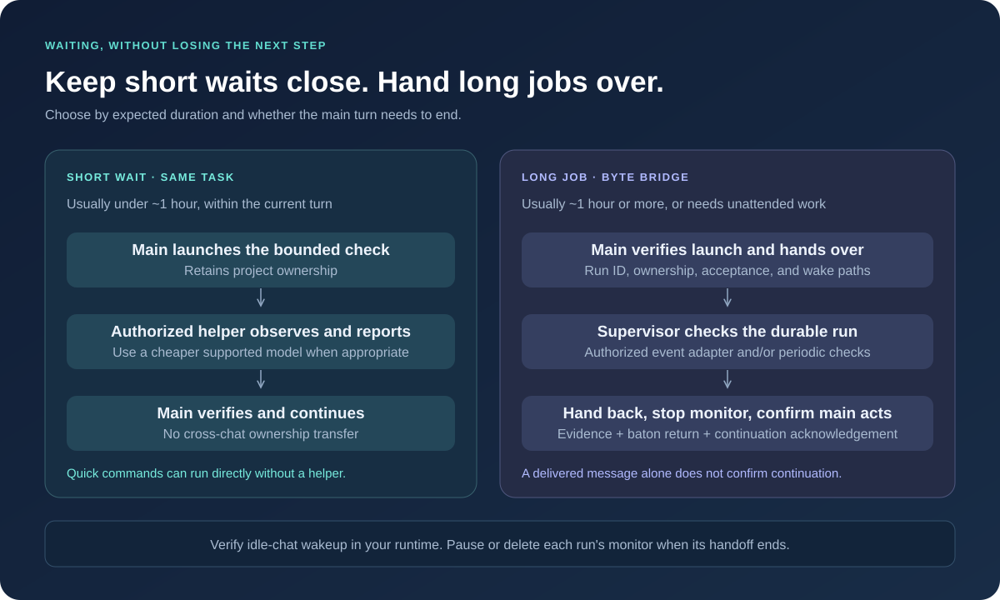

<p align="center">
  
</p>

<h1 align="center">Byte Skills</h1>

<p align="center"><strong>A workflow that fits the task, from an idea to a verified result.</strong><br />Compose discussion, research, implementation, review, and long-running handoffs.</p>

<p align="center">
  <a href="#choose-a-skill"></a>
  <a href="#quick-start"></a>
  <a href="LICENSE"></a>
  <a href="README.zh-CN.md"></a>
</p>

<p align="center">
  <a href="README.zh-CN.md">简体中文</a> · <strong>English</strong><br />
  <a href="#overview">Overview</a> · <a href="#quick-start">Quick start</a> · <a href="#example">Example</a> · <a href="#choose-a-skill">Skills</a> · <a href="#short-waits-and-long-jobs">Supervision</a> · <a href="#outcome-continuity">Outcome continuity</a>
</p>

---

**Organize around the outcome. Let evidence guide the next step.** Byte Skills is a composable family of `byte-*` skills read and executed by your coding assistant. Small tasks stay simple; larger tasks combine research, planning, implementation, and verification as needed.

Your client keeps its models and tools. Skills guide the procedure, and local helper scripts record handoffs and evidence. Messaging, subagents, and automation depend on the client's capabilities and user authorization.

| Capability | What it gives you |
| --- | --- |
| **Compose what is useful** | Start mixed requests with `byte-do`, or invoke a focused skill directly. There is no required fixed pipeline. |
| **Preserve the overall outcome** | `byte-auto` distinguishes a completed stage from an accepted overall result and advances authorized next steps. |
| **Evidence before claims** | Assess progress using actual code, tests, runtime receipts, and sources. |
| **Recoverable collaboration** | Relay records exact session identity, ownership, handoffs, and artifact evidence. |
| **Explicit authority boundaries** | Long-running checks, cross-chat actions, paid resources, and destructive operations each retain their authorization requirements. |

## Overview



## Quick start

You need Git, Bash, Python 3, and a coding assistant that can load local `SKILL.md` files. The installer and Relay scripts use the Python standard library.
For custom YAML workflows, `uv run` isolates the script's PyYAML dependency. JSON inputs also work directly with Python 3.

```bash
git clone https://github.com/elan6666/byte-skills.git
cd byte-skills
./install.sh --all
```

This installs 14 skills into `~/.agents/skills` and `~/.codex/skills`. Refresh the skill list or reopen the conversation as required by your client.

```text
$byte-do Describe the change you need; choose the relevant skills and verify the result
$byte-auto Complete this feature through the default workflow until acceptance passes
$byte-discuss Compare these directions and help me choose the scope
$byte-bridge Hand this verified long run to my designated supervisor chat
$byte-workflow Save my research loop with steps, conditions, acceptance and session roles
```

`byte-do` turns a natural-language request into the appropriate skill combination.
`byte-auto` drives the default complete delivery workflow, adapting its depth to the task.
You can also discuss first, hand off a long job, or save your own reusable process.
These examples use Codex-style invocation; your client determines the trigger syntax.

For cross-chat collaboration, enable the bundled Bridge runtime explicitly:

```bash
./install.sh --all --bridge
```

Bridge requires Node.js 24.15–24.x; the other Byte skills keep their Python/Bash
requirements. This installs pinned npm dependencies, without starting models,
services or chats. Then use `$byte-bridge` to connect the selected original
sessions and inspect their capabilities. See the [Bridge guide](skills/byte-bridge/references/setup.md).

Other installation options:

```bash
./install.sh                              # Only ~/.agents/skills
./install.sh --target ~/.claude/skills     # Another skill directory
./install.sh --all --check                # Verify installed-copy parity
```

The installer replaces Byte skill directories with matching names. Save any local customizations first. Compatibility depends on the client's skill format and available tools; cross-conversation messaging and automation require runtime support. Install `zstd` separately only if you need to read compressed DSH sessions.

## Example

**GraD-Pert: from an experiment question to implementation and supervised follow-up.**
A real research project used Byte to compare ablation options, implement scoped changes,
verify the code, and pass readiness evidence to an existing supervisor without restarting
the active experiment. The prompts below use the current entry names and are adapted for reuse; the
historical project records predate `byte-bridge`.

```text
$byte-discuss What could explain this result? Compare experiment options against the existing baseline.
$byte-do Implement the chosen change, preserve baseline behavior, and run the relevant checks.
$byte-auto Continue the authorized experiment workflow; distinguish code readiness from validated results.
$byte-bridge Verify startup, hand the exact long run to the supervisor, then return evidence for main-chat verification and continuation.
```

**Observed snapshot, 31 October 2026:** design, implementation, local checks and a native
cross-chat readiness message were recorded. Hardware preflight and the proposed new
training runs were still pending. This example demonstrates the workflow, not a claim
of improved model quality or a completed research outcome.

[Read the walkthrough →](examples/gradpert.md) · [中文案例 →](examples/gradpert.zh-CN.md) · [All examples →](examples/README.md)

## Choose a skill

Start with one of these five common entries. Supporting skills can be selected as the
work progresses; you do not need to invoke every intermediate step.

| Entry | When to use it |
| --- | --- |
| [byte-do](skills/byte-do/SKILL.md) | Describe a task in natural language; automatically select and combine the relevant skills. |
| [byte-auto](skills/byte-auto/SKILL.md) | Drive the default delivery workflow: clarify, plan, implement, verify, repair and accept the overall result. |
| [byte-discuss](skills/byte-discuss/SKILL.md) | Clarify an idea, compare options, and settle scope or tradeoffs before building. |
| [byte-bridge](skills/byte-bridge/SKILL.md) | Connect chats or agent apps, assign roles, delegate scoped work, supervise exact runs and return results. Includes the Byte Bridge runtime. |
| [byte-workflow](skills/byte-workflow/SKILL.md) | Save custom steps, branches, loops, acceptance and role bindings locally for reuse across projects. |

| Supporting capabilities | Skills |
| --- | --- |
| Explore alternatives and check evidence | [byte-brainstorm](skills/byte-brainstorm/SKILL.md), [byte-research](skills/byte-research/SKILL.md) |
| Plan, implement, review and save deferred ideas | [byte-plan](skills/byte-plan/SKILL.md), [byte-build](skills/byte-build/SKILL.md), [byte-review](skills/byte-review/SKILL.md), [byte-future](skills/byte-future/SKILL.md) |
| Inspect progress and maintain handoff records | [byte-status](skills/byte-status/SKILL.md), [byte-relay](skills/byte-relay/SKILL.md), [byte-design-supervise](skills/byte-design-supervise/SKILL.md) (training preset) |

## Short waits and long jobs



| Situation | Preferred approach |
| --- | --- |
| A quick command | Run it directly in the main task |
| A bounded test expected within about an hour and the current turn | Use an authorized same-task subagent; the main chat retains ownership and verifies the result |
| Training, ablations, or batch work expected to take about an hour or more, or to outlive the main turn | Use an identified supervisor chat with authorized event notifications or scheduled checks |

Duration is a routing estimate. Delegation and model choice depend on runtime support and user authorization. Reassess the route when a short job takes longer than expected.

Cross-chat operations now go through `byte-bridge`, using the runtime maintained in this repository.
`byte-design-supervise` remains its training/ablation preset; `byte-relay` retains
local evidence and legacy owner helpers. Byte owns the workflow and acceptance;
Bridge owns transport and supervision records, not a second work baton.

For a long job, the main chat first verifies that it started, records the run identity, logs, acceptance criteria, and repair scope, then commits the engine handoff and imports it through `byte-bridge`. The supervisor handles only the agreed scope, returns the terminal evidence, and disables that run's monitor. The main chat verifies the result and advances the next authorized stage.

**A delivered cross-chat message does not prove that the main chat resumed.** Automatic continuation requires working wake paths in both directions and an observable acknowledgement. `run_event.py` records process exits and calls a configured notifier; waking an idle Codex chat still needs verification in the target environment. Without a tested event adapter, scheduled checks can take up to one check interval to detect a change. See the [supervision workflow](skills/byte-design-supervise/references/workflow.md) and [event bridge notes](skills/byte-relay/references/codex-event-bridge.md).

### Supported agent routes

The bundled runtime has version/mode-specific connectors for Codex, Claude Code,
dsh, Hermes, Pi, ZCode, Kimi Code and OpenCode. New Byte workflow-v1 instances
accept their exact owner references. Native-session attachment and managed
sessions remain distinct; no arbitrary GUI/TUI or idle-wake guarantee is implied.
Existing projects require explicit source binding and committed-handoff import;
installing an update does not migrate an active job. See the
[Byte integration contract](skills/byte-bridge/references/byte-workflow.md).

## Recoverable handoffs

Ordinary work does not require `.byte-os/`. When a project needs resumable cross-chat work or explicit handoffs, Relay keeps its records inside the project:

```text
.byte-os/coordination/
├── state.json       # Current owner, stage, next action, and acceptance
├── sessions.json    # Session ID, client, model provenance, and Git snapshot
├── handoffs/        # Handoff notes and session digests
├── receipts/        # Execution, verification, and artifact evidence
└── reviews/         # Review packages when needed
```

Each coordination state has one write owner. Messages notify participants; project files, code, and runtime evidence establish the facts. Model identity is verified only when supported by native runtime evidence. The skills do not select or switch models themselves.

```text
$byte-relay Initialize handoff state for this project
```

Legacy Relay includes local session-digest readers for Codex, Claude Code, DSH, and ZCode. Digest access does not imply live messaging support. A full ZCode conversation summary still needs its native tools. See the [coordination schema](skills/byte-relay/references/coordination-schema.md) for details.

## Reusable local workflows

```text
$byte-workflow Save a research loop with result analysis, problem characterization,
literature, solution design, implementation, experiment, and renewed analysis.
Reuse it in other projects with separate parameters and main/supervisor bindings.
```

Install the bundled `experiment-research` template into your local library:

```bash
uv run skills/byte-workflow/scripts/workflow.py install-template
uv run skills/byte-workflow/scripts/workflow.py list-templates
```

Templates live at `~/.byte/workflows/<id>/workflow.yaml`. Each project pins a
snapshot in `.byte-os/workflow.yaml` and uses the existing
`.byte-os/coordination/state.json` for runtime state. Library edits cannot
silently change an active project. Steps can belong to main or supervisor;
conditional transitions, loop boundaries and acceptance are configurable.

Revision checks and stable event IDs prevent stale/duplicate transitions.
Source-hashed receipts establish recorded step evidence; an empty reply cannot
acknowledge substantive main continuation. Short waits retain main ownership;
long waits transfer an unarmed baton and then require supervisor acknowledgement
and recorded native monitoring before a justified wait. Only verified overall
acceptance completes a workflow; explicit pause and external blockage are separate.

Use `validate`, `init`, `status`, `advance`, `accept`, `start-run`, `arm-run`,
`return-run`, `ack-return`, `record-run`, `route`, `doctor` and `export` through
the CLI. See the [format and commands](skills/byte-workflow/references/format.md).
The engine records and validates decisions; it neither executes model commands
nor creates a native scheduler. Real client wakeups still require configuration
and observation.

## Outcome continuity

An authorized long-running or iterative task keeps one overall outcome and acceptance checklist. Research, preflight, training, and reports are stages. The main conversation verifies each handback, then executes the next authorized action. A supervisor checks only its exact active run and disables that run's monitor after handback.

Explicit user pauses, scope boundaries, and resource limits always take precedence. Ordinary tasks use ordinary conversation state; Goal mode requires an explicit request. Standalone status questions or discussions do not grant new execution authority.

A local exit check uses the existing state to distinguish completion, verified supervised waiting, an explicit pause, and a concrete external blocker:

```bash
python3 skills/byte-auto/scripts/continuation_check.py --state /path/to/state.json
```

Use `--help` for the record schema. Exit `0` permits the disposition returned by the check, `2` requires continued substantive work, and `1` requires state/evidence reconciliation. See the [long-running work contract](skills/byte-auto/references/long-running-work.md).

The helper checks consistency of local records. It cannot intercept a client's final response or independently prove live scheduling, wakeups, or scientific correctness. It does not guarantee a solution to an open research problem.

## Maintenance and verification

For an explicitly requested continuous two-chat research loop, keep one
outcome-level heartbeat across experiments and active analysis, literature
review, and implementation. The supervisor watches the current run or quietly
checks main-chat progress. If the main chat is idle with authorized ready work,
retarget the same heartbeat to main for recovery. End checks of a completed run
without disabling the overall recovery path. Stale reminders route from current
state. Preserve the user's chosen research order; see the
[continuous research procedure](skills/byte-design-supervise/references/research-loop.md).

`skills/byte-auto/scripts/continuation_route.py --help` documents the read-only
routing helper. Native configuration, readback and observed scheduled execution
are still required. Heartbeats can consume model quota. Stop this authorized
outcome monitor on verified completion, an explicit pause, or an evidenced
external blocker with no independent work remaining.

```bash
python3 scripts/sync_shared_references.py --check
python3 -m unittest discover -s tests -v
```

The retained regression tests cover session registration and authority, handoffs, task receipts, process events, duplicate-launch prevention, and failure-delivery states. They run in temporary directories without a model API, GPU, or external account. They do not verify a client's scheduling or automatic wakeup behavior.

To change the shared evidence contract, edit `shared/evidence-contract.md` and run `python3 scripts/sync_shared_references.py`. Each consuming skill bundles a copy so it can be installed independently.

## License

[MIT](LICENSE). Inspired by team-based workflows; not affiliated with ByteDance. Product and company names belong to their respective owners.

## Bridge development

The complete former SessionBridge project is now maintained **only here**, in
[`packages/byte-bridge`](packages/byte-bridge/README.md): source, native adapters,
plugins, unit/integration/live test sources, packaging tools and documentation.
The former standalone project is retired. Existing `session-bridge` commands and
`sessionbridge_*` protocol names remain compatibility aliases.

- `packages/byte-bridge/`: canonical editable project.
- `skills/byte-bridge/`: user-facing skill and launcher.
- `skills/byte-bridge/runtime/`: generated installation payload; do not edit directly.

```bash
npm --prefix packages/byte-bridge ci --ignore-scripts
npm --prefix packages/byte-bridge run lint
npm --prefix packages/byte-bridge run typecheck
npm --prefix packages/byte-bridge test
python3 -m unittest discover -s packages/byte-bridge/tests/python
python3 scripts/build_bridge_runtime.py --build
python3 scripts/build_bridge_runtime.py --check
```

These checks do not run account-dependent live tests or start an agent service.
Runtime hashes bind installations to the Byte source tree; rebuilding never
reads a separate SessionBridge repository. Historical import provenance lives
in `packages/byte-bridge/ORIGIN.json`.
