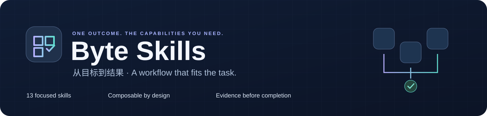
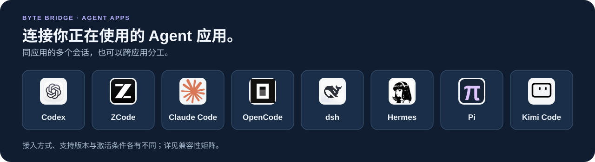
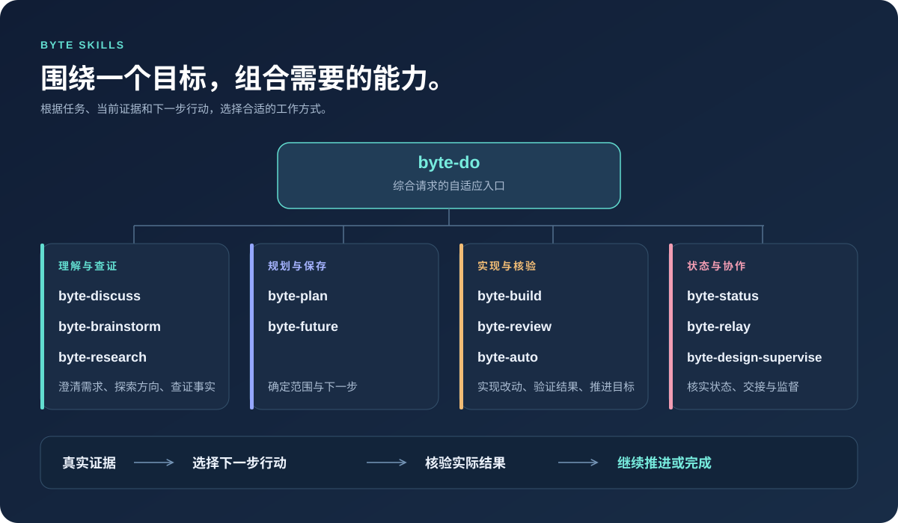
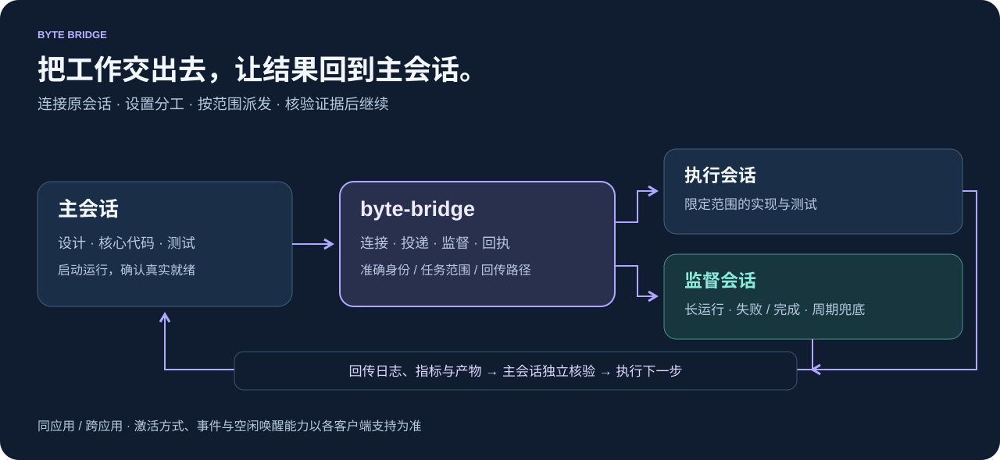
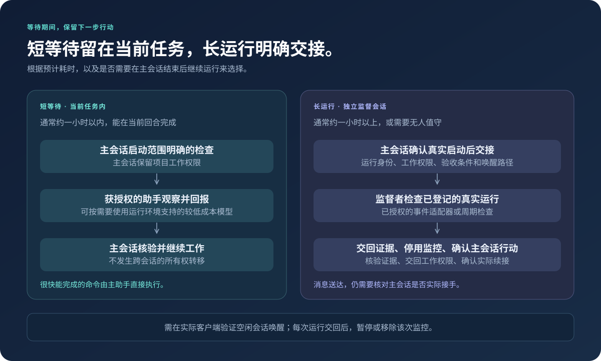

<p align="center">
  
</p>

<h1 align="center">Byte Skills</h1>

<p align="center"><strong>让 AI 编码助手按任务选择工作方式，从想法推进到经过验证的结果。</strong><br />讨论、研究、构建、评审与长任务交接，按实际需要组合。</p>

<p align="center">
  <a href="#skills"></a>
  <a href="#quick-start"></a>
  <a href="LICENSE"></a>
  <a href="README.md"></a>
</p>

<p align="center">
  <strong>简体中文</strong> · <a href="README.md">English</a><br />
  <a href="#overview">技能总览</a> · <a href="#quick-start">快速安装</a> · <a href="#byte-bridge">Byte Bridge</a> · <a href="#example">实际案例</a> · <a href="#skills">常用入口</a> · <a href="#supervision">长任务协作</a> · <a href="#continuity">持续推进</a>
</p>

---

**围绕目标组织工作，让证据决定下一步。** Byte Skills 是一组可组合的 `byte-*` 技能，由你正在使用的编码助手读取执行。简单任务直接完成；复杂任务按需要选择研究、规划、实现和核验能力。

客户端继续提供原来的模型和工具。Skills 指导工作方式，配套本地脚本记录交接和证据；跨会话消息、子代理与自动化依赖客户端能力及用户授权。

| 能力 | 对用户的作用 |
| --- | --- |
| **按需组合** | 综合请求从 `byte-do` 开始，明确改动直接使用对应技能；不强制固定流水线。 |
| **以结果为目标** | `byte-auto` 区分阶段完成与整体目标达标，继续推进已授权的后续工作。 |
| **证据优先** | 根据实际代码、测试、运行收据与来源判断进展，避免只凭文字状态报喜。 |
| **可恢复协作** | Byte Bridge 连接会话、派发任务并回传证据；Byte 工作流管理所有者和验收。 |
| **明确授权边界** | 长运行检查、跨会话操作、付费资源及破坏性动作各自遵守实际授权。 |

<p align="center"><strong>Byte Bridge 连接你正在使用的 Agent 应用</strong></p>


[接入模式与支持版本](packages/byte-bridge/docs/support.md) · [图标来源](assets/agents/README.md)

<a id="overview"></a>

## 技能总览



<a id="quick-start"></a>

## 快速开始

需要 Git、Bash、Python 3，以及能够加载本地 `SKILL.md` 的编码助手。安装器和 Relay 脚本使用 Python 标准库。
自定义工作流的 YAML 编辑支持通过 `uv run` 隔离加载 PyYAML；JSON 输入也可直接使用 Python 3。

```bash
git clone https://github.com/elan6666/byte-skills.git
cd byte-skills
./install.sh --all
```

这会把 14 个技能安装到 `~/.agents/skills` 和 `~/.codex/skills`。安装后刷新技能列表或重新打开会话；按客户端要求操作。

```text
$byte-do 用自然语言描述需求，自动选择合适技能并验证结果
$byte-auto 按默认完整流程完成这个功能，直到验收通过
$byte-discuss 比较几个方向，帮我明确需求和取舍
$byte-bridge 将确认启动的长任务交给我指定的监督会话
$byte-workflow 保存我的研究循环，包括步骤、条件、验收和会话分工
```

`byte-do` 根据自然语言请求自动组合对应技能；`byte-auto` 自动推进默认完整交付流程，
按任务调整深度。也可以先讨论、交接长任务，或保存自己的可复用流程。
以上是 Codex 风格的调用示例，实际触发语法由客户端决定。

需要跨会话协作时，显式安装内置 Bridge 运行时依赖：

```bash
./install.sh --all --bridge
```

Bridge 需要 Node.js 24.15–24.x；其他 Byte 技能仍按 Python/Bash 要求使用。
这个命令只安装固定版本的 npm 依赖，不启动模型、服务或新会话。
随后用 `$byte-bridge` 连接指定的原会话并核实能力，详见 [Bridge 指南](skills/byte-bridge/references/setup.md)。

其他安装方式：

```bash
./install.sh                              # 仅安装到 ~/.agents/skills
./install.sh --target ~/.claude/skills     # 指定其他技能目录
./install.sh --all --check                # 检查已安装副本是否一致
```

安装器会替换目标目录中同名的 Byte 技能；请先保存自行修改的版本。支持程度取决于客户端的技能格式和工具能力，跨会话通信与自动化需要相应的运行环境。只有读取 DSH 压缩会话时才需要额外安装 `zstd`。

<a id="byte-bridge"></a>

## Byte Bridge：跨会话与跨 Agent 协作

**保留原来的聊天，把工作交出去，让结果回到主会话。**
`byte-bridge` 是 Byte 内置的协作能力：连接同一应用或不同 Agent 应用中选定的会话，
设置分工，再按明确范围派发任务。执行会话可以实现一个模块，监督会话可以检查长时间训练，
主会话等待结果。各应用继续保留原来的上下文、模型、账号和工具权限，Bridge 内核自身不调用模型 API。



| 你想做什么 | 可以这样说 |
| --- | --- |
| 连接会话、安排角色 | “这个会话做主会话，连接同项目中我指定的评审会话。”只连接和设置角色，不会启动任务或监控。 |
| 派发独立任务 | “让那个执行会话实现这个模块，只改这些目录，运行指定测试并回传产物。” |
| 监督长时间运行 | “监督这个已确认启动的训练，失败或完成时回报，并用每 30 分钟检查兜底；仅在约定范围内修复。” |
| 回传结果、继续推进 | “把日志、指标和产物哈希交回，主会话独立核验后执行下一步。” |

### 试用一个双会话实验流程

运行 `./install.sh --all --bridge` 后，在**原主会话**调用技能，明确项目和你要使用的监督会话：

```text
$byte-bridge 这个会话做主会话，我指定的实验监督会话做监督者，协作同一个项目。
先核实双方的原生身份和连接。实验获授权后，主会话先确认训练真实启动，再交接准确的
运行 ID、日志、验收条件和允许修复的范围。使用已验证的失败/完成事件通知，
并用每 30 分钟查询兜底。运行结束后交回证据、停用本次监控，主会话独立核验，
然后继续我们约定的实验流程。
```

1. **连接与确认分工。** 双方各自在原应用的原会话中接入，核对项目、会话身份和实际支持的投递方式。
2. **启动与交接。** 主会话设计实验、实现代码并测试，确认真实启动后交接准确运行；
   监督者确认接手，检查与回传路径经过验证后，主会话再等待。
3. **按范围监督。** 监督者检查自己负责的运行，只做已授权的修复并回传终态证据。
   事件通知和空闲会话唤醒受应用与适配器限制；周期检查提供兜底。
4. **核验与继续。** 主会话检查产物与验收标准，再执行下一项已授权工作。
   单次运行的监控在交回后停用；你明确要求的整体研究循环监控按自己的结束条件管理。

`byte-do` 按需选择这项能力；`byte-auto` 在默认完整交付流程中衔接协作；
`byte-workflow` 保存自定义步骤、循环、验收和主／监督会话分工；
`byte-design-supervise` 提供训练与消融预设。短时间、同任务内的辅助工作仍可用原生 subagent。

连接器覆盖 **Codex、Claude Code、dsh、Hermes、Pi、ZCode、Kimi Code 和 OpenCode**，
各有版本、激活方式和会话模式边界；接入原会话与新建受控会话是不同模式。
详见[安装与连接](skills/byte-bridge/references/setup.md)、
[兼容性矩阵](packages/byte-bridge/docs/support.md)和
[Byte 工作流接入契约](skills/byte-bridge/references/byte-workflow.md)。

完整 Bridge 工程在本仓库的 [`packages/byte-bridge`](packages/byte-bridge/README.zh-CN.md)
统一维护，安装包由此生成，无需另一个 SessionBridge 项目。

<a id="example"></a>

## 实际案例

**GraD-Pert：从实验问题，到代码实现与跨对话监督衔接。**
真实研究项目中，我们用 Byte 比较消融方案、实现限定范围的改动、验证代码，
再将就绪证据交给既有监督会话，不重启正在运行的实验。以下提示词按当前入口名称改写，方便复用；历史项目记录早于 `byte-bridge`，不是新入口已经执行过这些实验的声明。

```text
$byte-discuss 这个结果可能说明什么？基于已有基线比较几个消融方案。
$byte-do 实现选定改动，保持基线行为不变，并运行相关检查。
$byte-auto 持续推进已授权的实验流程，区分代码就绪与实验结果通过验收。
$byte-bridge 确认启动后交接准确的长任务；监督者回传证据，主会话核验并继续。
```

**2026 年 10 月 31 日记录快照：** 已有方案、实现、本地检查和原生跨对话就绪消息；
硬件预检与新提议的正式训练尚待执行。案例展示工作方式，不声称模型质量已提升或研究目标已完成。

[阅读完整案例 →](examples/gradpert.zh-CN.md) · [English walkthrough →](examples/gradpert.md) · [案例目录 →](examples/README.md)

<a id="skills"></a>

## 常用入口

优先选择下面五个入口。中间能力按需衔接，一般不需要逐个手动调用。

| 入口 | 什么时候用 |
| --- | --- |
| [byte-do](skills/byte-do/SKILL.md) | 自然语言描述任务，自动选择并组合对应技能。 |
| [byte-auto](skills/byte-auto/SKILL.md) | 自动推进默认完整流程：明确目标、规划、实现、核验、修复，直到整体验收。 |
| [byte-discuss](skills/byte-discuss/SKILL.md) | 讨论想法、比较方案，先明确需求、范围和取舍。 |
| [byte-bridge](skills/byte-bridge/SKILL.md) | 连接会话或不同 Agent 应用，设置角色、派发任务、监督准确运行并回传结果；自带 Byte Bridge 运行时。 |
| [byte-workflow](skills/byte-workflow/SKILL.md) | 自定义步骤、分支、循环、验收和分工，保存到本地并跨项目复用。 |

| 中间能力 | 对应技能 |
| --- | --- |
| 探索备选方案、查证外部证据 | [byte-brainstorm](skills/byte-brainstorm/SKILL.md)、[byte-research](skills/byte-research/SKILL.md) |
| 规划、实现、评审与保存后续想法 | [byte-plan](skills/byte-plan/SKILL.md)、[byte-build](skills/byte-build/SKILL.md)、[byte-review](skills/byte-review/SKILL.md)、[byte-future](skills/byte-future/SKILL.md) |
| 查看进度、维护交接记录 | [byte-status](skills/byte-status/SKILL.md)、[byte-relay](skills/byte-relay/SKILL.md)、[byte-design-supervise](skills/byte-design-supervise/SKILL.md)（训练预设） |

<a id="supervision"></a>

## 短等待与长任务



| 情况 | 推荐方式 |
| --- | --- |
| 很快能完成的命令 | 主助手直接执行 |
| 预计约 1 小时以内、能在当前回合完成的测试等待 | 获授权的同会话子代理；主会话保留所有权并核实结果 |
| 预计约 1 小时以上，或需要主会话结束后继续的训练、消融、批处理 | 明确的监督会话与已授权的事件通知或定时检查 |

时长是选择方式的参考。子代理和模型选择受运行环境及用户授权约束；等待时间超出预期时，应重新评估监督方式。

跨会话操作统一使用本仓库维护的 `byte-bridge`。
`byte-design-supervise` 保留为训练／消融预设，`byte-relay` 保留本地证据和旧版权限辅助工具。
Byte 管工作流与验收，Bridge 管投递、监督和回执，不再建立第二套工作所有者。

长任务由主会话先确认真实启动，记录运行身份、日志、验收标准和修复范围，先通过引擎提交交接，再由 `byte-bridge` 导入并投递。监督会话只处理约定范围内的问题，任务结束后交回证据，并停用本次运行的监控。主会话核实结果后推进已授权的下一阶段。

**跨会话消息送达不代表主会话已经恢复执行。** 自动续跑需要双向唤醒路径和实际接手确认。`run_event.py` 可以记录进程退出事件并调用配置的通知器；空闲 Codex 会话能否被唤醒，仍需在目标环境中验证。没有经过验证的事件适配器时，定时检查有一个检查周期的发现延迟。详见[监督流程](skills/byte-design-supervise/references/workflow.md)和[事件桥接说明](skills/byte-relay/references/codex-event-bridge.md)。

### Agent 接入范围

内置运行时包含 Codex、Claude Code、dsh、Hermes、Pi、ZCode、Kimi Code 和 OpenCode 的版本／模式限定连接器，
新版 Byte workflow-v1 支持它们的准确所有者引用。原会话接入与新建受控会话仍有区别，不能承诺任意 GUI/TUI 或空闲唤醒。
既有项目需要显式绑定源码、导入已提交交接；安装更新不会迁移活动任务。
详见 [Byte 接入契约](skills/byte-bridge/references/byte-workflow.md)。

## 可恢复的交接

普通工作不需要 `.byte-os/`。需要可恢复的工作或明确交接时，Byte 在项目内保存工作流记录：

```text
.byte-os/coordination/
├── state.json       # 当前所有者、阶段、下一步与验收标准
├── sessions.json    # 会话 ID、客户端、模型来源与 Git 快照
├── handoffs/        # 交接说明和会话摘要
├── receipts/        # 执行、验证与产物证据
└── reviews/         # 需要时生成的评审材料
```

同一份协调状态只有一个写入所有者。消息负责通知；项目文件、代码和运行证据用于核实事实。模型信息只有在有运行时证据时才视为已验证，技能本身不负责切换模型。

```text
$byte-status 查看这个项目的当前所有者、阶段和交接证据
```

Relay 包含 Codex、Claude Code、DSH 和 ZCode 的本地会话摘要读取支持；摘要不等于实时消息能力。ZCode 的完整会话摘要仍需由其原生工具补充。实现细节见[协调状态说明](skills/byte-relay/references/coordination-schema.md)。

## 本地自定义工作流

```text
$byte-workflow 创建一个实验研究循环：结果分析、问题表征、文献、方案、实现、实验、再分析。
保存到本地模板库；新项目复用时重新绑定项目参数和主／监督会话。
```

自带 `experiment-research` 模板。安装到本地模板库：

```bash
uv run skills/byte-workflow/scripts/workflow.py install-template
uv run skills/byte-workflow/scripts/workflow.py list-templates
```

模板在 `~/.byte/workflows/<模板名>/workflow.yaml`。每个项目保存自己的 `.byte-os/workflow.yaml` 快照，并在既有 `.byte-os/coordination/state.json` 中运行。全局模板以后修改，不会改变已启动的项目。

步骤可以分配给主会话或监督会话，支持条件分支、循环返回和独立验收。状态推进需要匹配版本号、稳定事件 ID 和带来源哈希的证据；空回复无法替代主会话的实际接手。短等待保留主会话所有权，长等待使用先交接、再确认监控生效的两阶段流程。整体验收通过才完成；显式暂停和真实外部阻塞有独立状态。

CLI 提供 `validate`、`init`、`status`、`advance`、`accept`、`start-run`、`arm-run`、`return-run`、`ack-return`、`record-run`、`route`、`doctor` 和 `export`。详见 [格式与命令](skills/byte-workflow/references/format.md)。它检查本地状态与证据，不直接执行模型命令或创建定时任务；实际客户端调度仍需配置与验证。

<a id="continuity"></a>

## 持续推进，而不丢失整体目标

对于已经授权的长期或迭代任务，保存一个整体目标与验收清单。研究、预检、训练和报告分别是阶段成果；主会话核验交回结果后，继续下一项已授权工作。监督者只检查自己负责的准确运行，交回后停用本次监控。

如果你明确要求用双会话定时持续推进，使用同一个**整体目标定时任务**跨阶段续接：运行中监督当前实验；主会话分析、查文献和实现时，由监督会话低频检查它是否仍活跃；主会话空闲但有已授权工作时，将同一定时任务转向主会话恢复执行。结束旧运行的查询，不会暂停整个研究循环。旧阶段提醒必须以最新目标和所有权重新分流。详见[持续研究流程](skills/byte-design-supervise/references/research-loop.md)。

这种模式会保留你指定的研究顺序，例如“实验结果 → 问题表征 → 文献 → 方案 → 实现与实验 → 分析 → 下一轮”。检查助手可输出当前应恢复主会话、监督运行还是保持安静：

```bash
python3 skills/byte-auto/scripts/continuation_route.py --help
```

它只读取状态并给出分流决定；实际定时任务仍须通过客户端配置、回读验证并观察真实触发。自动化唤醒可能消耗模型额度，只有整体目标达标、明确暂停或存在真实外部阻塞时才停用这类获授权的持续检查。

明确的用户暂停、范围与资源限制始终优先。普通任务默认使用普通会话状态；只有用户要求时才使用 Goal。单独询问状态或讨论方向，不会凭空产生执行权限。

配套退出检查根据已有状态，区分实际完成、已验证的监督等待、用户暂停和具体外部阻塞：

```bash
python3 skills/byte-auto/scripts/continuation_check.py --state /path/to/state.json
```

用 `--help` 查看记录结构。退出码 `0` 允许检查结果所对应的退出方式，`2` 表示仍需继续实质工作，`1` 表示状态或证据需要对账。详见 [持续工作约定](skills/byte-auto/references/long-running-work.md)。

这个脚本核对本地记录的一致性，不能拦截客户端结束回复，也不能单独证明调度、唤醒或科学结论正确。未知研究问题不能保证必然有解。

## 维护与验证

```bash
python3 scripts/sync_shared_references.py --check
python3 -m unittest discover -s tests -v
```

保留的回归测试覆盖会话登记与权限、交接、执行收据、进程事件、重复启动防护和失败通知状态。它们在临时目录中运行，不需要模型 API、GPU 或外部账号，也不验证客户端的定时调度或自动唤醒。

修改共享证据约定时，编辑 `shared/evidence-contract.md`，再运行 `python3 scripts/sync_shared_references.py`。每个使用它的技能都携带自己的副本，便于独立安装。

## 许可

[MIT](LICENSE)。项目受团队式工作方式启发，与字节跳动无隶属关系；文中产品与公司名称归各自权利人所有。

## Bridge 开发与维护

原 SessionBridge 的完整产品工程已合并，后续**只维护本 Byte 仓库**：
[`packages/byte-bridge`](packages/byte-bridge/README.zh-CN.md) 包含源码、原生适配器、
插件、单元/集成/真实测试源码、打包工具和文档。原独立项目停止维护。
既有 `session-bridge` 命令和 `sessionbridge_*` 协议名保留为兼容别名。

- `packages/byte-bridge/`：唯一可编辑的完整工程。
- `skills/byte-bridge/`：用户入口和启动器。
- `skills/byte-bridge/runtime/`：从上述工程生成的安装包，不直接修改。

```bash
npm --prefix packages/byte-bridge ci --ignore-scripts
npm --prefix packages/byte-bridge run lint
npm --prefix packages/byte-bridge run typecheck
npm --prefix packages/byte-bridge test
python3 -m unittest discover -s packages/byte-bridge/tests/python
python3 scripts/build_bridge_runtime.py --build
python3 scripts/build_bridge_runtime.py --check
```

这些检查不会运行需要账号的真实测试或启动 Agent 服务。安装包以源码树哈希绑定
Byte 内部源码，构建不再读取独立 SessionBridge 仓库；历史导入来源保留在
`packages/byte-bridge/ORIGIN.json`。

应用市场 ZIP 仍展示同样的 14 个 Byte 入口。适配器内部说明以可阅读的
`SKILL.template.md` 打包，由 `install.sh` 在源码与运行包完整性检查前恢复；说明内容不变。
