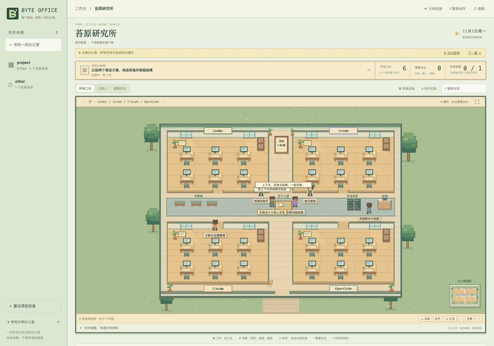

# Byte Office

[简体中文](README.zh-CN.md) · English

A living, top-down **2D pixel office** for Byte Skills. A project becomes an office
map, each harness has a room, and each chat becomes a character with its own desk.
Characters walk through doors and corridors, work, read, water plants, get coffee,
and meet their collaborators. Maps, sprites and furniture are original artwork.



## Run

Requires Node.js **24.15–24.x**, the same range as the bundled Bridge runtime.
No additional npm dependencies, database setup or model calls are needed.
From the Byte repository:

```bash
bash scripts/workbench.sh
# Open http://localhost:4317 and select a project.
```

Pin a project directory, use a different port, or disable native catalog discovery:

```bash
bash scripts/workbench.sh --project /absolute/path/to/project --port 4317
bash scripts/workbench.sh --no-discovery --project /absolute/path/to/project
```

Or run an isolated example office without reading real client databases:

```bash
cd apps/byte-workbench
npm run demo
# http://localhost:4318/?project=demo-office
```

The server binds only to `127.0.0.1`. Keep the process running while using the
workbench; Ctrl+C stops it. It does not install a background service or scheduler.

## What you can see

Characters follow a local state machine and grid-based pathfinding:

| Recorded state | Scene behavior |
| --- | --- |
| Working | Walk to the assigned desk, type and review notes. |
| Idle or current task finished | Read, water plants, get coffee, look out of a window or stroll. |
| Waiting for a long job | Alternate between the desk and break area; a supervisor visits experiment equipment. |
| Newly confirmed cross-chat handoff | Both characters walk to the shared table, exchange a file, talk, then return. |
| Failure or input required | Return to the desk with an attention marker; this interrupts cosmetic handoff activity. |
| Unknown or stale | Wait for synchronization and consult the noticeboard, with a question marker. This is not evidence of native idleness. |

Movement is a visualization of saved state, not a native client execution probe.
It does not send agent messages, inspect processes, call a model or advance real
workflows. Opening a character's details preserves the original evidence limits.

Drag to pan, scroll or use +/− to zoom, select **全景** to fit, and **⛶** for full
screen. Characters and the noticeboard are clickable. **暂停动作** freezes scene
motion while state synchronization continues; **1×/2× 生活** changes scene speed.
**名册** provides keyboard-accessible character selection. Rooms page through six
characters at a time; additional harnesses have additional floors.

The clearly labeled example office automatically plays five synthetic scenes,
about 22 seconds each. Its story can be paused or advanced manually; real projects
only react to source updates.

| View | Source and meaning |
| --- | --- |
| Project map | Explicitly pinned directories and local Codex/Zcode catalog metadata. A project must be selected; no implicit first project. |
| Harness zones and desks | Codex/Zcode titles, IDs, model metadata when provided, and parent-child relationships. Any harness with exact Bridge bindings also appears. |
| Collaboration | Bridge tasks, delivery receipts, native observation records, results, verification and main-chat continuation. |
| Project noticeboard | Saved Byte workflow step, iteration, acceptance checklist and next action. Checklist entries are recorded claims, not freshly reverified scientific results. |
| Experiment equipment | Registered run identity, PID, supervision configuration and scheduled check time. A stored PID is not a live process probe. |
| Evidence | Registered task artifacts; checked against SHA-256 and confined to the selected project before being served. |

Select a desk for details. Search chats, filter registered desks or tasks needing
attention, copy a chat ID, and follow a Codex deep link when supported by the
client. Other harnesses get a copyable ID; the workbench does not guess their URLs.

State is reread every **2.5 seconds** and streamed to the selected office through
SSE. This updates the dashboard without querying a language model. The animated
example demonstrates handoff → supervision → input → verification → continuation;
it is always labeled as synthetic. Newly confirmed deliveries trigger a meeting
once. Initial historical receipts do not replay past collaboration.

## Task desk and project recall

**任务台** filters the loaded task window by state or words in the goal and
acceptance criteria. Open a task for participants, artifact links and event
history. Older events use stable sequence cursors; repeated pages are deduplicated.
History is scoped to that exact project, task and its delivery subjects.

**项目记忆** searches saved project notes, lessons, coordination and the newest
5000 Bridge task summaries. Chinese substring and mixed-language conjunctive
queries work. Search returns short extracts; expand only useful entries, with
their source and SHA-256. A changed source requires searching again. Copying one
entry includes its provenance and its historical-data boundary.

This is source-backed lexical retrieval, not automatic transcript capture, AI
summarization, semantic search or automatic injection into agent chats. Sources
are reread on demand and never changed. `<private>` blocks and common credentials
are redacted before indexing; avoid storing arbitrary secrets in notes.

The same helper works from an installed `byte-status` skill, without this server:

```bash
node skills/byte-status/scripts/recall.mjs --project /absolute/project --query 'database migration'
```

[Source scope, character budgets and limitations](../../skills/byte-status/references/project-recall.md).
No new dependencies, model calls, monitors or execution authority are added.

## Status boundaries

- A recently edited catalog entry does **not** prove that its chat is running.
- An unexpired Bridge registration does **not** prove that an agent is online.
- Bridge schema 8 observations lack timestamps. A stored `running` observation is
  displayed as a historical execution record. Stale or uncertain records use
  synchronization-waiting behavior; work poses describe recorded task state.
  This version does not offer a live token stream or tool transcript.
- Transport receipt, native execution observation, result report, independent
  verification, and overall acceptance remain separate states.
- A saved supervision configuration is not evidence that the scheduler is active
  or that the remote process is alive. Existing Byte supervision still owns those
  checks; this workbench does not create or run them.
- Claude, OpenCode, DSH, Hermes, Pi and Kimi are visible when registered through
  Bridge. Automatic native catalog import is currently limited to Codex and Zcode.
- Projects are scoped by canonical directory. Worktrees and different host paths
  are not silently merged into the same office.

## Local data and permissions

The adapter opens existing SQLite databases read-only and never initializes,
migrates or repairs them. It reads metadata, not full native chat transcripts:

```text
~/.codex/state_5.sqlite
~/.zcode/cli/db/db.sqlite
SELECTED_PROJECT/.session-bridge/{project.json,bridge.sqlite}
SELECTED_PROJECT/.byte-os/coordination/state.json
```

“Register project” only writes `~/.config/byte-workbench/projects.json` (override
with `--config /absolute/settings.json`). It does not connect a chat, grant
permissions, delegate tasks, start training, change ownership, acknowledge a
return, or create an automation. There are no agent execution endpoints.

Database queries are bounded: up to 500 chats per native catalog and 500 tasks
per project; the timeline displays recent events. Counts describe that loaded
window, not an unlimited archive. Missing/incompatible sources produce an
explicit warning or unknown state.

Artifact access requires a selected project, task ID, registered artifact index,
matching hash, allowed extension and a real path inside the project. Dotfile paths
are blocked. Text is served as plain text; images/PDFs download as binary files.
The endpoint does not execute HTML, SVG or Markdown content. Cross-origin and
unexpected Host requests are rejected; the page uses no remote scripts, fonts,
analytics or assets. This is a local desktop companion, not a public server.

## Verify

```bash
cd apps/byte-workbench
npm run check
npm test

# Optional Chromium UI test, using an existing local executable:
CHROME_BIN=/absolute/path/to/chromium node tests/browser-smoke.mjs \
  --output /absolute/path/to/local-test-results
```

Tests cover exact project isolation, read-only database preservation, expired
identities, distinct runtime generations, stale native observations, terminal
task precedence, workflow loops, artifact confinement/hash checks, origin/Host
checks, and SSE updates. The browser check exercises real SQLite → SSE → DOM
updates, demo progression, search, details, script-safe text rendering and a
390px viewport. Game tests cover door/furniture pathfinding, autonomous leisure,
work and attention states, meetings and return paths, queued handoff deduplication,
pause and project switches. Browser checks observe changing character coordinates,
click the actual canvas character, and watch a real scene meeting after a new
fixture receipt. Tests use disposable databases and do not modify live tasks.

Implementation: `server.mjs` provides the loopback API, `lib/` projects existing
state, `public/office-model.js` implements behavior and navigation, and
`public/office-game.js` renders the world, characters, camera and interactions. No
Bridge runtime source or ownership protocol is replaced.

The full roster uses current client display names, prioritizes main chats and
locates any loaded chat across floors/pages. Search by name or native ID; selecting
a result brings its character into view and opens details. Six desks per room
remain a map capacity, not the total conversation count.

## Display registration, plans and Mission Control (v0.4)

Live projects now show only explicitly registered chats. Use **登记展示会话** to
select participants, or uncheck them to remove them from display. Catalog discovery
is only a candidate picker; it grants no execution permissions.

Pixel Office and **协作指挥台** share the selected participants. Solid edges show
actual project Bridge tasks; dashed edges show registered collaboration plans.
Matching participants alone never proves that a particular saved plan executed.

The task board records objectives, solutions, steps and acceptance criteria. Done
steps require evidence references. Progress is a count of recorded completed steps,
not independently accepted outcomes or inferred runtime progress. Native catalogs,
Bridge and workflow state remain read-only. The editable local planning/display
ledger is `.byte-os/workboard.json`, with revision checks, locking and atomic writes.

Updated Byte skills tell the current host agent to maintain enabled project plans
as discussion and work advance. This does not install a conversation watcher or
call an extra model from the web app. [Agent instructions and schema](../../skills/byte-plan/references/workboard.md).
