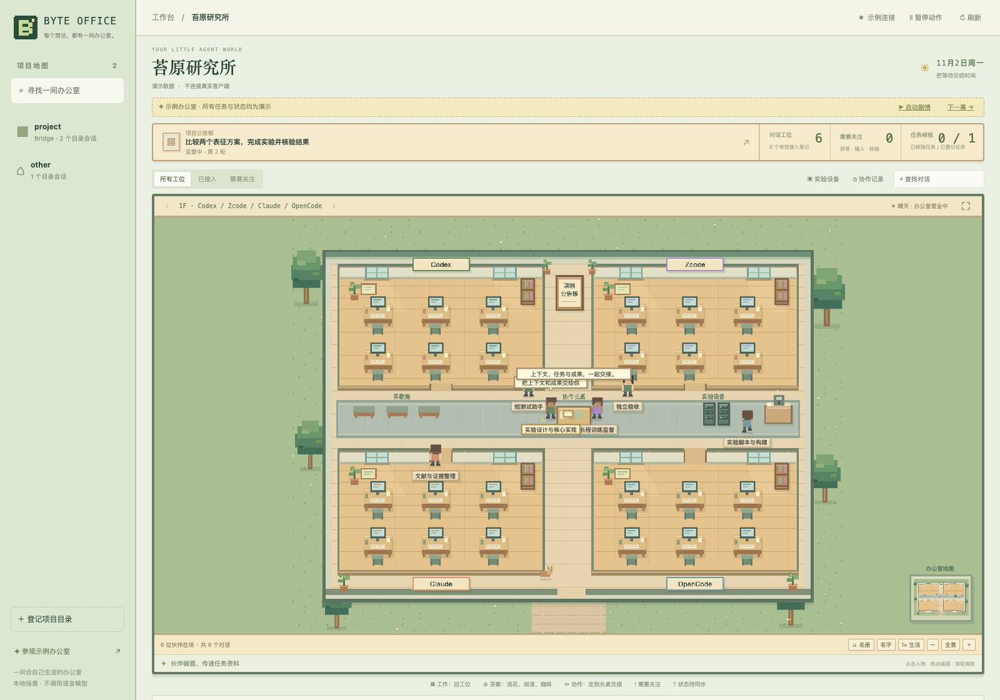

# Byte Office · 可视化工作台

简体中文 · [English](README.md)

给 Byte Skills 一间会自己生活的 **2D 像素办公室**：一个项目是一张办公室地图，
一个 harness 是一个房间，一个对话是一位有自己工位的伙伴。人物能穿门、沿走廊
行走，在工位、书架、窗边、咖啡角和协作长桌之间活动。地图、人物和家具均为原创。



## 启动

需要 **Node.js 24.15–24.x**，与 Byte Bridge 的版本范围一致。无需额外 npm
依赖、模型调用或数据库部署。在 Byte 仓库根目录执行：

```bash
bash scripts/workbench.sh
# 浏览器打开 http://localhost:4317，先选择项目。
```

可以指定常用项目、端口或关闭客户端目录发现：

```bash
bash scripts/workbench.sh --project /项目/绝对路径 --port 4317
bash scripts/workbench.sh --no-discovery --project /项目/绝对路径
```

只看独立示例，不读取真实客户端数据库：

```bash
cd apps/byte-workbench
npm run demo
# http://localhost:4318/?project=demo-office
```

服务只监听 `127.0.0.1`。使用时保持进程运行；Ctrl+C 停止。
不会安装常驻服务或定时任务。

## 可以看什么

### 伙伴会做什么

| 登记状态 | 场景中的动作 |
| --- | --- |
| 工作 | 回到自己的电脑前，敲键盘、翻看资料。 |
| 空闲或本轮任务已结束 | 自己选择阅读、浇花、喝咖啡、看窗外或在休息区走动。 |
| 等待长任务 | 在工位与茶歇区之间活动；监督角色会去实验设备区巡视。 |
| 新的跨对话交接确认 | 双方沿走廊去协作长桌碰面、递交文件、交流，再返回自己的分区。 |
| 报错或需要输入 | 回工位举起求助标记；需要关注的状态优先于交接动画。 |
| 状态未知或记录陈旧 | 带「?」等待同步、查看公告或资料；不会据此宣称真实 Agent 空闲。 |

动作由本地游戏状态机与网格寻路驱动，绕开墙壁和家具。人物走动不调用模型，
也不会在真实客户端发消息、检查服务器或推进任务。人物行为是记录的视觉演绎；
点击人物可核对具体来源与真实任务记录。

示例办公室进入后默认自动播放五幕虚构剧情，每幕约 22 秒；可暂停剧情或手动
下一幕。真实项目只随记录更新，不自动推进真实任务。

### 操作

- 点击人物：查看对应会话、任务和产物；点击地图中的公告板：查看项目工作流。
- 拖动画面、滚轮或「＋／−」：平移与缩放；「全景」还原视角，「⛶」进入全屏。
- 「暂停动作」停止人物运动，状态记录仍会同步；「1×／2× 生活」调整场景速度。
- 「名册」提供可用键盘选择的人物列表；可切换名字显示。
- 每个房间显示六位伙伴，更多会话使用房间分页；更多 harness 使用楼层切换。

| 区域 | 内容 |
| --- | --- |
| 项目地图 | 手动登记的项目，以及本地 Codex、Zcode 目录中发现的项目；先选项目，再进入办公室。 |
| 分区与工位 | 对话名称、ID、已知模型、角色、子代理关系；通过 Bridge 登记的其他 harness 也会出现。 |
| 协作时间线 | 任务、投递、接收、执行观察、结果、独立核验和主会话继续推进的记录。 |
| 项目公告板 | 保存的工作流步骤、循环轮次、验收清单与下一步。清单反映登记记录，不代表本工作台重新验证了实验。 |
| 实验设备区 | 运行 ID、记录的 PID、监督配置、计划巡检时间；进程是否存活需要原监督器确认。 |
| 产物入口 | 读取前校验登记的 SHA-256，并限制在当前项目中的任务产物。 |

点击人物查看详情；可搜索对话、筛选接入登记或待处理项、复制会话 ID。
Codex 提供客户端支持时可用的深链接；其他客户端不猜测 URL。

状态每 **2.5 秒**读取一次，通过 SSE 更新当前办公室，不消耗语言模型额度。
示例办公室可以逐步演示“交接 → 监督 → 等待输入 → 核验 → 主会话继续”，始终
明确标注为演示。新的传输确认触发一次碰面交接；首次载入的历史记录不重复播放。

## 任务台与项目记忆

**任务台**可以按状态或任务、验收关键词筛选。点开任务，查看参与会话、
带哈希检查的产物入口，以及该任务与投递消息的事件历史。更早记录使用稳定序号
分页、去重；不会混进其他项目的事件。任务列表仍是最多 500 条的已加载窗口。

**项目记忆**检索本项目的 STATE、LESSONS、协调状态和最近 5000 个 Bridge
任务摘要。支持中文子串及中英文多关键词共同匹配。先返回短摘要，只展开需要的
详情，并附上来源与 SHA-256；来源变化后须重新检索。复制单条上下文会保留来源。

这是按需重建索引的本地关键词检索，不会自动采集完整对话、调用模型压缩记忆、
做语义检索或向 Agent 自动注入。源文件和 Bridge 数据库只读，不另存永久副本。
私密标签及常见密钥模式在索引前处理，但不能保证识别散文中的任意敏感信息。

也可直接使用随 `byte-status` 安装的独立脚本，无需启动工作台：

```bash
node skills/byte-status/scripts/recall.mjs --project /absolute/project --query '验收条件'
```

[完整来源范围、字符预算与限制](../../skills/byte-status/references/project-recall.md)。
这两项能力不增加 npm 依赖、模型调用、定时任务或执行权限。

## 状态如何理解

- **发现对话 ≠ 正在执行**。目录更新时间不能证明 Agent 此刻在思考或调用工具。
- **接入登记有效 ≠ 在线**。未提供的信息显示未知，不从消息数量推断工作进度。
- 现有 Bridge schema 8 的原生观察没有时间戳。陈旧或来源不确定的记录用等待同步
  动作表现；工作姿态描述登记状态，不是实时在线证明。本版不提供实时 token 流。
- 投递、接收、执行、结果回报、独立核验、整体目标达标分别显示。
- 实验设备展示监督登记，不探测远程进程，也不创建或代替现有监督定时任务。
- Codex、Zcode 支持自动发现本地对话目录；Claude、OpenCode、DSH、Hermes、Pi、
  Kimi 等通过 Bridge 登记进入对应分区。
- 项目以规范化后的目录隔离；不会擅自把不同 worktree 或不同主机路径合成一个项目。

## 数据范围

只读现有数据库，不创建、迁移、修复客户端或 Bridge 数据库。默认读取元数据，
不会读取完整原生对话正文：

```text
~/.codex/state_5.sqlite
~/.zcode/cli/db/db.sqlite
当前项目/.session-bridge/{project.json,bridge.sqlite}
当前项目/.byte-os/coordination/state.json
```

“登记项目”只保存工作台自己的 `~/.config/byte-workbench/projects.json`；可以用
`--config /配置/绝对路径.json` 更换位置。不会启动 Agent、连接新会话、授予权限、
派发任务、启动训练、转移所有权、确认返还或创建自动化。本版没有任务执行接口。

每个原生目录最多载入 500 个对话、每个项目最多载入 500 个任务，时间线展示近期
事件；统计仅描述已载入窗口，不代表无限历史。来源缺失、不可读或版本不兼容时保留
未知状态或明确提示。

产物入口必须匹配当前项目、任务、登记索引和 SHA-256。真实路径必须在项目内，
禁止点文件路径，单文件最多 8MB。文本用纯文本展示；图片/PDF 下载；不会执行
HTML、SVG 或 Markdown。服务拒绝跨域来源和异常 Host，不加载外部字体、脚本、
统计服务或素材。该工作台面向本机使用。

## 验证

```bash
cd apps/byte-workbench
npm run check
npm test

# 可选：使用本机已有 Chromium 做真实界面测试。
CHROME_BIN=/浏览器/绝对路径 node tests/browser-smoke.mjs \
  --output /本地测试结果/绝对路径
```

自动测试覆盖项目隔离、数据库只读、过期身份、运行代次、陈旧观察、终态优先级、
工作流循环、产物边界与哈希、同源保护和 SSE。浏览器测试验证真实 SQLite 修改
驱动 SSE 与界面更新、示例流程、搜索、详情、不执行外部文本和 390px 窄屏。
测试使用临时数据库，不修改真实任务。游戏测试覆盖房间间寻路、自动休息行为、
工作与求助状态、交接碰面与返回、交接去重、暂停和项目切换；浏览器还验证实际人物
坐标持续变化、直接点击地图人物、暂停、缩放以及新交接后的双方碰面。

`server.mjs` 是本地接口，`lib/` 读取现有状态，`public/office-model.js` 是游戏状态机
和寻路，`public/office-game.js` 绘制地图、人物、相机与互动。
本功能属于 Byte 仓库，不替换 Bridge 的执行或所有权协议。

完整名册使用客户端当前显示名称，主会话优先排列；搜索支持名称或会话 ID。
点击名册条目会切换至正确楼层和分页，并打开对应人物详情。每区仍只显示六位伙伴，
未显示在当前地图中不代表对话不存在。

## 展示登记、任务方案与协作指挥台（v0.4）

真实项目默认不展示任何历史会话。点击“登记展示会话”，勾选本次需要关注的对话；
取消勾选并保存即可退出展示。目录发现只为登记选择器提供候选，不代表接入或执行授权。

像素办公室与科技风“协作指挥台”是两种视图，共用同一批登记会话与任务来源。
指挥台的实线来自实际项目 Bridge 任务；虚线来自合作计划登记。登记分工后，会显示
关联方案步骤进度，并列出这些参与者之间匹配到的 Bridge 任务记录，但不会把同一组
参与者的其他任务误称为该方案已经执行。没有匹配记录就明确显示“仅登记计划”。

“任务与方案”可保存目标、方案、步骤、验收条件。状态分待办、进行中、受阻、待核验、
完成；标记步骤完成必须提供证据引用。百分比仅表示登记步骤完成率，引用内容仍须独立
核验，不能当成模型实时估计、科学目标达成或整体验收。

状态保存在所选项目的 `.byte-os/workboard.json`，有修订检查、独占写锁和原子替换。
它不改写原生聊天数据库、Bridge 或工作流引擎。UI 保存的是展示/方案元数据。
使用已更新的 Byte Do/Discuss/Plan/Build/Auto 时，当前 Agent 会根据讨论结果维护
启用项目的任务板；网页本身不会监听所有聊天或调用另一个模型自动编造方案。

[Agent 使用及字段说明](../../skills/byte-plan/references/workboard.md)。
