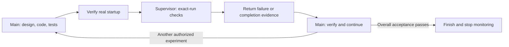

# GraD-Pert: discussion, implementation and supervised follow-up

[Back to examples](README.md) · [简体中文](gradpert.zh-CN.md) · [Repository home](../README.md#example)

GraD-Pert is a machine-learning research project with iterative experiments and
long-running training. The useful question is not “how do we call all 13 skills?”
It is “how do we move from a result to the next justified experiment, while
keeping the code, evidence and ownership clear?”

This walkthrough is based on owner-provided local Codex records from
29–31 October 2026. **Prompts are adapted examples, not a verbatim transcript
or proof that every named entry was explicitly invoked.**

## 1. Discuss the next experiment

The main chat compared precision-ablation options against an existing two-epoch
baseline. It checked the current implementation and public references, separated
hypotheses from conclusions, and distinguished a hardware adaptation from a full
reproduction of another model's training recipe.

```text
$byte-discuss Our latest experiment leaves an unresolved representation issue.
Compare a few precision-ablation options against the existing baseline.
Explain what each would test, which controls must stay fixed, and what evidence
would support or reject the hypothesis. Discuss first; do not launch training.
```

Use `byte-discuss` when the direction still needs a decision. A useful output is
a scoped comparison and acceptance plan, not an unsupported promise of improvement.

## 2. Describe the implementation in natural language

After the user selected the experiments, the main chat prepared isolated changes,
self-contained configurations and relevant regression checks. It also corrected
the evaluation protocol after checking the historical baseline implementation.
The active experiment stayed under its existing supervisor.

```text
$byte-do Implement the selected ablations and their checks. Keep the baseline
behavior and evaluation protocol comparable. Record what passed locally and
what still requires hardware validation. Preserve the active run and its owner.
```

`byte-do` selects the relevant supporting skills from the request. Planning,
building, research and review are intermediate capabilities; the user need not
issue a separate command for every one.

## 3. Continue toward the overall result

Use `byte-auto` when you want the default complete delivery workflow rather than
a single scoped change. It adapts planning, implementation, tests, review and
repair to the task, and keeps overall acceptance separate from stage readiness.

```text
$byte-auto Continue the authorized experiment workflow. Use the agreed baseline,
resource limits and acceptance criteria. Verify the code, then the hardware
preflight, then the permitted experiments and their results. Diagnose and repair
within the agreed scope. A readiness report is a stage; resume the next authorized
step until overall acceptance passes or there is a concrete blocker.
```

In the reviewed snapshot, the main chat completed local implementation and
readiness work and sent the next dependencies to the supervisor. The new hardware
preflight and proposed training were still pending. This is evidence of a staged
handoff, not of a completed research objective.

## 4. Hand a long job to a supervisor chat

The main and supervisor chats were integrated with the local Byte workflow.
The supervisor followed the owned run while the main prepared independent
follow-up work. A later native message carried readiness evidence and remaining
preflight dependencies without restarting the active experiment.

```text
$byte-design-supervise For this authorized long experiment, the main chat owns
design, core code, tests and launch. Confirm a durable run ID and real startup
before handoff. Use my designated supervisor and the existing approved monitor;
do not create a duplicate. Verify supervisor acknowledgement, monitoring and
the return-wake route before the main ends its turn to wait.

The supervisor checks only the exact owned run and agreed repair scope. On
failure or completion, return the logs, exit status and artifacts. The main must
independently verify them and actually resume the next authorized step.
```



`byte-relay` supplies the underlying identity, ownership and handoff records.
Short bounded waits can use an authorized same-task helper instead. Cross-chat
messaging, scheduling and model choice come from the client. A terminal event
can be recorded immediately; without a tested event-to-chat adapter, discovery
is periodic. A delivered message alone does not prove resumed execution.

Stop an ordinary run's monitor after handback. If the user explicitly authorizes
a continuous research loop, keep one outcome-level monitor across phases and
stop it when the overall outcome is accepted, explicitly paused, or blocked
with no independent work remaining.

## Optional: save the research loop

```text
$byte-workflow Save this locally for reuse:
experiment results -> characterize the issue -> literature -> solution design
-> implementation and checks -> experiment -> analysis.
Loop when evidence does not meet the fixed acceptance criteria.
Main owns design, implementation, startup and final verification.
Supervisor owns agreed long-run checks and returns evidence for continuation.
Bind new project parameters and sessions when reusing it.
```

The reusable definition lives in `~/.byte/workflows/<id>/workflow.yaml`.
Each project pins its own `.byte-os/workflow.yaml` snapshot and runtime records.
Saving a definition does not create a schedule or authorize a new training job.

## What the records establish

| Observed in the reviewed records | What remains separate |
| --- | --- |
| Discussion, implementation, local checks and an evidence-backed readiness handoff | Hardware preflight and the proposed new training runs were pending in the 31 October snapshot. |
| Main/supervisor integration and native cross-chat coordination | Scientific quality and overall acceptance still require experiment evidence. |
| Isolated CPU tests exercised intentional failure, repair, independent verification and scheduled continuation | Those tests are distinct from GraD-Pert research-scale training and do not establish immediate event-triggered chat wakeup. |

The public example omits server addresses, private paths, chat IDs, raw receipts
and unpublished experiment artifacts. Reuse the procedure with your own project
and acceptance criteria.
