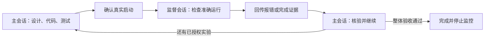

# GraD-Pert：讨论、实现与跨对话监督衔接

[案例目录](README.md) · [English](gradpert.md) · [返回首页](../README.zh-CN.md#example)

GraD-Pert 是一个需要反复实验、包含长时间训练的机器学习研究项目。
我们关心的是如何从结果走向下一项有依据的实验，同时保持代码、证据与会话分工清楚。

案例基于项目所有者提供的 2026 年 10 月 29—31 日本地 Codex 记录。
**提示词经过改写，方便其他项目复用；不是逐字会话记录，也不表示每个入口都曾显式调用。**

## 1. 先讨论下一轮实验

主会话围绕已有两轮基线比较精度消融方案，核对当前实现与公开资料，
区分待检验假设和已经验证的结论，并明确硬件适配方案与完整复现他人配方的区别。

```text
$byte-discuss 最近的实验还没有解释表征问题。基于已有基线比较几个精度消融方案。
每组要检验什么？哪些控制条件必须固定？什么证据可以支持或否定假设？
先讨论，不启动训练。
```

方向尚未确定时使用 `byte-discuss`。产出应是有取舍的方案和验收设计，
不能把预期收益提前写成实验结论。

## 2. 用自然语言描述实现任务

用户选定实验后，主会话准备隔离实现、自包含配置与相关回归检查，
并在核对历史基线源码后修正评估口径。正在运行的实验仍归原监督会话负责。

```text
$byte-do 实现选定的消融和对应检查。保持基线行为与评估协议可比。
记录本地已经通过什么、哪些还需要硬件验证。保留当前运行及其所有者。
```

`byte-do` 自动根据请求选择对应技能。规划、构建、研究和评审属于中间能力，
一般无需用户逐项手动调用。

## 3. 让默认完整流程继续推进

需要推进整体任务时使用 `byte-auto`：自动衔接规划、实现、测试、评审和修复，
按任务调整深度，区分阶段就绪与整体目标通过验收。

```text
$byte-auto 继续推进已授权的实验流程，遵守约定的基线、资源限制与验收标准。
先核验代码，再完成硬件预检，随后执行允许的实验并分析结果；在授权范围内诊断修复。
就绪报告只是阶段产物，完成后执行下一项已授权工作，直到整体验收通过或遇到具体阻塞。
```

已核对的快照中，主会话完成了本地实现与就绪材料，并将后续依赖发给监督会话；
新实验的硬件预检和正式训练仍待执行。这证明了阶段衔接，不能算研究目标已经完成。

## 4. 把长任务交给监督会话

主会话与监督会话已经接入本地 Byte 工作流：监督者跟踪自己负责的运行，
主会话准备可独立推进的后续工作。后来的原生跨对话消息携带就绪证据与待执行预检，
没有重启正在运行的实验。

```text
$byte-design-supervise 这项已授权的长实验，由主会话负责设计、核心代码、测试和启动。
先确认真实启动和持久运行 ID，再交给我指定的监督会话。
复用现有获授权的监控，不创建重复定时任务；确认监督者接手、监控生效和返回唤醒路径后，
主会话再结束当前回合等待。

监督者只检查准确的当前运行，修复不超出约定范围。
报错或完成时回传日志、退出码与产物；主会话独立核验后，实际开始下一项已授权工作。
```



底层的准确身份、所有权和交接记录由 `byte-relay` 支持。短时间等待可以使用获授权的
同任务子代理；跨会话通信、定时检查和模型选择依赖客户端。进程终态可以立即记录，
但没有通过真实测试的事件唤醒适配器时，会话仍通过定时检查发现变化；消息送达也不等于已恢复执行。

普通单次运行在交回后停用其监控。用户明确授权持续研究循环时，才保留一个跨阶段的
整体目标监控，直到整体验收、明确暂停，或出现已无独立工作可做的外部阻塞。

## 可选：保存自己的研究循环

```text
$byte-workflow 将下面的流程保存到本地，以后复用：
实验结果 → 问题表征 → 文献 → 方案 → 实现与检查 → 实验 → 分析。
证据不满足固定验收条件时，返回问题表征进入下一轮。
主会话负责设计、实现、启动与最终核验；监督会话负责约定的长运行检查，回传证据后继续衔接。
在新项目中复用时，重新绑定项目参数和具体会话。
```

可复用定义保存在 `~/.byte/workflows/<id>/workflow.yaml`；每个项目固定自己的
`.byte-os/workflow.yaml` 快照与运行记录。保存定义不会创建定时任务，也不会授权新的训练。

## 记录证明了什么

| 已核对的记录 | 仍需单独验证 |
| --- | --- |
| 方案讨论、代码实现、本地检查与带证据的就绪交接 | 10 月 31 日快照中的硬件预检与新提议训练仍待执行。 |
| 主／监督会话接入及原生跨对话协作 | 科学质量与整体验收仍需要实际实验结果。 |
| 隔离 CPU 测试覆盖故意报错、修复、独立验收和定时恢复执行 | 测试不等于 GraD-Pert 研究规模训练，也不能证明即时事件唤醒。 |

公开案例省略服务器地址、私人路径、会话 ID、原始收据和未公开实验产物。
复用的是工作方式，项目参数与验收标准由你自己指定。
